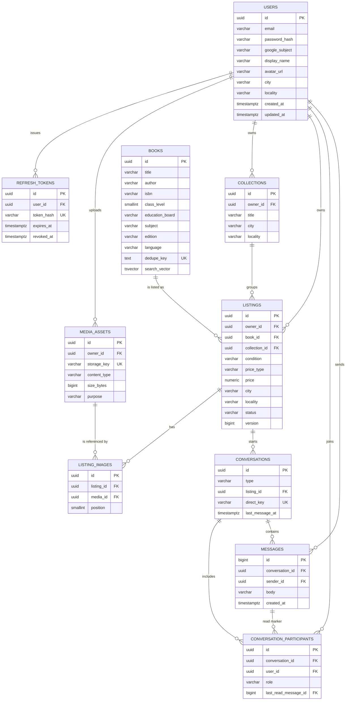

# Entity Relationship Diagram

## Notes

- `listings.collection_id` is nullable. The composite foreign key
  `(collection_id, owner_id)` prevents a seller from attaching a listing to
  somebody else's collection at the database level.
- `books.dedupe_key` and `books.search_vector` are generated columns. They are
  derived data and must never be written by the application.
- `conversations.direct_key` is a canonical `listing:userA:userB` string with the
  two user UUIDs sorted. The unique index enforces one direct thread per listing
  and pair.
- `conversation_participants.last_read_message_id` is a soft pointer to the newest
  message the participant has read; it is `NULL` before the first read.
- Deletes cascade from users to their sessions, media, listings, collections,
  participants and messages. Books are protected with `ON DELETE RESTRICT`.
